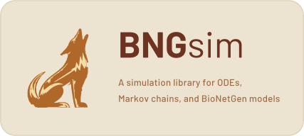

# bngsim

**A simulator for biochemical reaction networks, as a Python library.**

`bngsim` simulates models written in SBML, Antimony and the BioNetGen language
(BNGL). It integrates a model as ordinary differential equations or runs it as
an exact stochastic simulation. A rule-based model can also be run network-free,
with NFsim or RuleMonkey, from the XML that BioNetGen writes. The same `Model`,
`Simulator` and `Result` objects serve every format. A model is loaded once and
simulated in-process, and each run returns NumPy arrays.

Beyond time courses, `bngsim` computes forward sensitivities, finds steady
states, runs parameter scans and thread-parallel batches, and converts models
between formats. The engine is C++ on SUNDIALS, and it installs with `pip`. For
BioNetGen users it replaces the subprocess-based `run_network` driver.

> **Status: alpha (0.x).** bngsim is checked every night against BioNetGen,
> libRoadRunner, AMICI and the SBML test suite, but it is early software, and
> bugs that give a wrong answer without an error are still open. They carry the
> [`correctness concern`](https://github.com/lanl/bngsim/issues?q=is%3Aissue%20state%3Aopen%20label%3A%22correctness%20concern%22)
> label. Before you rely on a result for a new model, check it against a second
> engine or a tighter tolerance, and please report what you find.

## Installation

```bash
pip install bngsim
```

Prebuilt wheels ship for common platforms, with the sparse (KLU) solver bundled.
See the [installation guide](https://bngsim.readthedocs.io/en/latest/installation.html)
for the platforms covered, source builds and the KLU dependency.
[`SUPPORT_MATRIX.md`](https://github.com/lanl/bngsim/blob/HEAD/SUPPORT_MATRIX.md)
lists what each wheel delivers, by platform, Python version and backend.

Some features need an extra:

| To | Install |
|---|---|
| load Antimony (`.ant`) models | `pip install 'bngsim[antimony]'` |
| load rule-based BNGL (`.bngl`) models, through BNG2.pl (needs Perl) | `pip install 'bngsim[bngl]'` |
| read results as a pandas DataFrame, as xarray, or save them as HDF5 | `pip install 'bngsim[pandas]'`, `'bngsim[xarray]'`, `'bngsim[hdf5]'` |
| differentiate through a solve with JAX | `pip install 'bngsim[jax]'` |

Sensitivities, along a trajectory or at a steady state, compile generated C, so
they need a C compiler on the machine, or the opt-in MIR JIT in a source build.
A run without them needs neither. Where a compiler is present, a model of 256
or more species and an exact stochastic run of a mass-action model are compiled
too, and the compiled libraries are cached on disk. Without one they run on the
interpreter
([compiled RHS](https://bngsim.readthedocs.io/en/latest/user-guide/codegen.html)).

## A first run

This runs as written after `pip install bngsim`. It writes a two-species network
to a file so that there is something to load. Put your own SBML, Antimony or BNGL
file in its place.

```python
from pathlib import Path

import bngsim

# A -> B at rate k, in BioNetGen's network (.net) format.
Path("model.net").write_text(
    """\
begin parameters
    1 k 0.5
end parameters
begin species
    1 A() 100
    2 B() 0
end species
begin reactions
    1 1 2 k
end reactions
begin groups
    1 A 1
    2 B 2
end groups
""",
    encoding="utf-8",
)

# Model.load reads .net, SBML (.xml, .sbml), Antimony (.ant) and BNGL (.bngl).
model = bngsim.Model.load("model.net")
sim = bngsim.Simulator(model, method="ode")
result = sim.run(t_span=(0.0, 10.0), n_points=101)

result.time                # (101,) NumPy array of time points
result.observables["A"]    # trajectory of observable "A"
result.species             # (101, 2) array, columns in model.species_names order

print(round(float(result.observables["A"][-1]), 4))  # 0.6738, which is 100 * exp(-5)
```

Three rules worth knowing from the start:

- `n_points` counts the first point. 101 points over `(0, 10)` are 0.1 apart.
- An ODE or stochastic run continues from the state the last one on that model
  ended in. Call `model.reset()` to start again from the initial state, as the
  next block does.
- A stochastic run draws a fresh seed unless you pass one. `result.seed` is the
  seed that was used.

`Model.from_sbml`, `Model.from_antimony`, `Model.from_net` and `Model.from_bngl`
load one format by name, and the SBML and Antimony loaders have `*_string` forms
that take the model as text.

The same model, by other methods:

```python
# Exact stochastic simulation (Gillespie's direct method).
model.reset()
ssa = bngsim.Simulator(model, method="ssa")
trajectory = ssa.run(t_span=(0.0, 10.0), n_points=101, seed=1)

# The steady state.
model.reset()
steady = bngsim.Simulator(model, method="ode").steady_state()
steady.concentrations      # A -> 0, B -> 100

# Forward sensitivities along the trajectory. This one needs a C compiler.
model.reset()
sens = bngsim.Simulator(model, method="ode", sensitivity_params=["k"])
result = sens.run(t_span=(0.0, 10.0), n_points=101)
result.sensitivities       # (101, 2, 1) array: time, species, parameter
```

The [quickstart](https://bngsim.readthedocs.io/en/latest/quickstart.html) covers
loading, setting parameters, stochastic runs and seeds, and the
[user guide](https://bngsim.readthedocs.io/en/latest/) covers network-free
simulation, events, scans and batches.

## What it does

| | |
|---|---|
| **Model formats** | SBML and Antimony; BNGL, through BNG2.pl; BioNetGen's `.net` networks. The network-free methods read the XML that BioNetGen writes, passed as `xml_path` |
| **Methods** | ODE integration (SUNDIALS CVODE, with a dense or a sparse KLU linear solver); exact stochastic simulation (`ssa`); the partial-scaling approximation (`psa`); network-free simulation with NFsim (`nf`) and RuleMonkey (`rm`) |
| **Analyses** | forward sensitivities to parameters and to initial conditions, including through events (CVODES); Fisher information; steady states, with their sensitivities; conservation laws; parameter scans |
| **Running** | thread-parallel batches (`run_batch`) and replicates with the GIL released; stepwise runs (`run_until`) with state changes between steps; stop conditions; a wall-clock limit on runs, batches and scans; a BNGL file's own actions (`run_bngl`) |
| **Results** | NumPy arrays, with access by observable name; pandas, xarray and HDF5 through extras |
| **Interchange** | `.net` to and from SBML; SBML to compartmental BNGL; SED-ML protocols; COMBINE (`.omex`) archives. A conversion can be validated by a round-trip ladder, which is a check and not a proof ([interchange](https://bngsim.readthedocs.io/en/latest/user-guide/interchange.html)) |

## What sets it apart

- **One library for deterministic, stochastic and network-free simulation.** A
  model loaded once can be integrated, run stochastically and solved for its
  steady state through one API, where the model admits each, with no
  translation between tools. For BNGL models, both network-free engines (NFsim
  and RuleMonkey) run in the same process as the rest.
- **It refuses what it cannot simulate faithfully.** A model with an algebraic
  rule, a `delay()` term, a fast reaction, or an SBML package that changes its meaning
  raises an error that names the construct. bngsim does not drop the construct
  and integrate a different system. The same holds for sensitivities: where a
  derivative cannot be computed correctly, the run says so.
- **Its results are compared with other simulators' every night.** In the
  nightly sweep, 589 of 592 BNGL models agree with BioNetGen's `run_network` to
  1e-4 (ODE), and 1,248 of the 1,323 BioModels ODE models agree with
  libRoadRunner to ~1e-4. Sensitivities are compared with AMICI and with finite
  differences, and SBML semantics with the SBML test suite. The reference
  engines run live once a week, and the other nights compare against their
  recorded results. The counts are read from the committed
  [baselines](https://github.com/lanl/bngsim/tree/HEAD/parity_checks/nightly/baselines),
  and a regression raises an alert.
- **It is built to be embedded.** A run starts no subprocess and writes no
  result files. The ODE and stochastic engines hold no global state, so many
  models and simulators coexist in one process, and the GIL is released during
  a run. Some steps do reach outside a run. BNG2.pl expands a `.bngl` file into
  a network, which is cached on disk. The C compiler builds compiled code, which
  is cached too. An NFsim run has effects on the whole process, among them one
  shared random-number stream
  ([what an NFsim run changes](https://bngsim.readthedocs.io/en/latest/user-guide/network-free.html#what-an-nfsim-run-changes-in-your-process)).
  [PyBNF](https://github.com/lanl/PyBNF) uses bngsim this way for parameter
  fitting ([guide](https://bngsim.readthedocs.io/en/latest/user-guide/pybnf.html)).

## If you know another tool

| Tool | You would write | In bngsim |
|---|---|---|
| libRoadRunner | `rr = roadrunner.RoadRunner("model.xml")` | `model = bngsim.Model.load("model.xml")`, then `sim = bngsim.Simulator(model)` |
| libRoadRunner | `rr.simulate(0, 10, 101)` | `result = sim.run(t_span=(0, 10), n_points=101)`. `result.as_roadrunner()` returns the array in `simulate`'s layout |
| libRoadRunner | `rr.reset()` | `model.reset()` |
| libRoadRunner | `rr["k"] = 0.5` | `model.set_param("k", 0.5)` |
| libRoadRunner | `rr.steadyState()` | `sim.steady_state().concentrations`. The model's own state is not moved |
| Tellurium | `te.loada(antimony_text)` | `bngsim.Model.from_antimony_string(antimony_text)` |
| BNG2.pl | `simulate({method=>"ode",t_end=>10,n_steps=>100})` | `sim.run(t_span=(0, 10), n_points=101)`: 100 steps are 101 points |
| BNG2.pl | `simulate({method=>"ssa",...})` | `bngsim.Simulator(model, method="ssa").run(...)` |
| BNG2.pl | `setParameter("k",0.5)`, `setConcentration("A()",50)` | `model.set_param("k", 0.5)`, `model.set_concentration("A()", 50)` |
| BNG2.pl | `resetConcentrations()` | `model.reset()` |
| BNG2.pl | a `.bngl` file's actions block | `bngsim.run_bngl("model.bngl")` |

## Documentation

Full documentation is hosted at **[bngsim.readthedocs.io](https://bngsim.readthedocs.io)**
and lives in [`docs/`](https://github.com/lanl/bngsim/tree/HEAD/docs):

- [Installation](https://bngsim.readthedocs.io/en/latest/installation.html) ·
  [Quickstart](https://bngsim.readthedocs.io/en/latest/quickstart.html)
- User guide: [loading models](https://bngsim.readthedocs.io/en/latest/user-guide/loading-models.html),
  [simulation](https://bngsim.readthedocs.io/en/latest/user-guide/simulation.html),
  [network-free](https://bngsim.readthedocs.io/en/latest/user-guide/network-free.html),
  [results](https://bngsim.readthedocs.io/en/latest/user-guide/results.html),
  [events](https://bngsim.readthedocs.io/en/latest/user-guide/events.html),
  [sensitivities](https://bngsim.readthedocs.io/en/latest/user-guide/sensitivities.html),
  [steady state](https://bngsim.readthedocs.io/en/latest/user-guide/steady-state.html),
  [compiled RHS and its artifact cache](https://bngsim.readthedocs.io/en/latest/user-guide/codegen.html),
  [SBML/SED-ML/OMEX interchange](https://bngsim.readthedocs.io/en/latest/user-guide/interchange.html)
- Reference: [API](https://bngsim.readthedocs.io/en/latest/reference/api.html) ·
  [expression language](https://bngsim.readthedocs.io/en/latest/reference/expressions.html)
- [Architecture](https://bngsim.readthedocs.io/en/latest/about/architecture.html) ·
  [benchmarks & validation](https://bngsim.readthedocs.io/en/latest/about/benchmarks.html)

The package ships console scripts for model conversion (`bngsim-sbml2net`,
`bngsim-net2sbml`, `bngsim-sbml2bngl`, `bngsim-validate-conversion`, `bngsim-omex`;
see [interchange](https://bngsim.readthedocs.io/en/latest/user-guide/interchange.html))
and `bngsim-cache` (equivalently `python -m bngsim.cache`), which reports on and
prunes the compiled-artifact cache that codegen fills, which nothing empties on
its own. See
[managing the artifact cache](https://bngsim.readthedocs.io/en/latest/user-guide/codegen.html#managing-the-artifact-cache).

## Benchmarks & validation

`bngsim` is faster than `run_network` on every SSA/PSA model measured
(geometric-mean speedup ~8.7× SSA), and scores 1577 `Match` on the SBML semantic test
suite with **zero** wrong-but-plausible answers. The methodology, the reproducible
harnesses and the figures as of the July 2026 release are in
[benchmarks & validation](https://bngsim.readthedocs.io/en/latest/about/benchmarks.html).
The model counts under "What sets it apart" come from the current nightly baselines,
and that page does not yet have them. Results for an earlier release (0.11.31) are in the
[SBML Test Suite Database](https://sbml.bioquant.uni-heidelberg.de/Submission/Details/72).

The committed nightly baselines and reference trajectories are under
[`parity_checks/`](https://github.com/lanl/bngsim/tree/HEAD/parity_checks). To re-run
the suites and reproduce the numbers (the pinned-fetch model, corpus provenance, tool
versions, and a no-download smoke path), see
[`REPRODUCING.md`](https://github.com/lanl/bngsim/blob/HEAD/REPRODUCING.md).

The nightly sweeps are run by a
[scheduled workflow](https://github.com/lanl/bngsim/blob/HEAD/.github/workflows/nightly-parity.yml),
which alerts on a regression in correctness or in solver work
([`parity_checks/nightly/`](https://github.com/lanl/bngsim/blob/HEAD/parity_checks/nightly/README.md)).
To check whether a change of yours slowed bngsim down, `benchmarks/perf_ab.py` times
two builds against each other on your machine (see
[Checking performance and parity](https://github.com/lanl/bngsim/blob/HEAD/CONTRIBUTING.md#checking-performance-and-parity)).

## Contributing

Build-from-source, test, and CI instructions are in
[`CONTRIBUTING.md`](https://github.com/lanl/bngsim/blob/HEAD/CONTRIBUTING.md)
and the [development docs](https://bngsim.readthedocs.io/en/latest/development/building.html).
Release history is in
[`CHANGELOG.md`](https://github.com/lanl/bngsim/blob/HEAD/CHANGELOG.md).

## License

MIT. See [LICENSE](https://github.com/lanl/bngsim/blob/HEAD/LICENSE) for the full text
and the Triad/LANL copyright notice.

Third-party code and model/test-data corpora that BNGsim redistributes are
listed, with their licenses, in [NOTICE](https://github.com/lanl/bngsim/blob/HEAD/NOTICE).

© 2026. Triad National Security, LLC. All rights reserved. This is a Los Alamos National
Laboratory open-source release; LANL software release reference **O5098**.

## Citation

If you use `bngsim` in your research, please cite:

> Preprint coming soon!

## Acknowledgments

BNGsim was developed and validated against RoadRunner, AMICI, COPASI, BioNetGen,
and the SBML/DSMTS test suites. See
[ACKNOWLEDGMENTS.md](https://github.com/lanl/bngsim/blob/HEAD/ACKNOWLEDGMENTS.md) for
citations.
