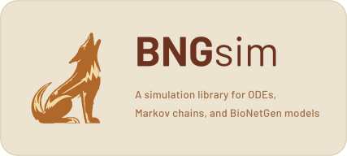

# BNGsim

**A simulator for biochemical reaction networks, as a Python library.**

BNGsim simulates models written in SBML, Antimony and the BioNetGen language
(BNGL). It integrates a model as ordinary differential equations or runs it as
an exact stochastic simulation. A rule-based model can also be run network-free,
with NFsim or RuleMonkey, from the XML that BioNetGen writes. The same `Model`,
`Simulator` and `Result` objects serve every format. A model is loaded once and
simulated in-process, and each run returns NumPy arrays.

It also computes forward sensitivities, finds steady states, runs parameter
scans and batches on parallel threads, and converts models between formats.
For BioNetGen users, it replaces `run_network`.
[PyBioNetGen](https://github.com/RuleWorld/PyBioNetGen) and
[PyBNF](https://github.com/lanl/PyBNF) use BNGsim.

BNGsim integrates ODEs with CVODES, which needs code that evaluates the
right-hand side of the ODEs and works best when also given the Jacobian and, for
sensitivity analysis, the derivatives with respect to parameters. A model file
provides none of these. BNGsim derives them from the model where it can. It also
handles what the solver leaves to its caller: events, discontinuities in rate
laws, sensitivities across those discontinuities, and methods other than ODE
integration.
[Why BNGsim?](https://bngsim.readthedocs.io/en/latest/about/why.html) explains
why this layer is needed, why it is hard to get right, and what BNGsim offers
beyond SciPy and NumPy.

- [When to use BNGsim](https://bngsim.readthedocs.io/en/latest/choosing.html):
  what it does and doesn't do, alternatives, and tips.
- [What BNGsim does](https://bngsim.readthedocs.io/en/latest/features.html):
  features, engines, and what sets it apart.

## For AI agents

- `bngsim.agent_guide()` returns a one-page
  [guide](https://bngsim.readthedocs.io/en/latest/agent-guide.html) for the
  installed version, with no network. `python -m bngsim guide` prints it, and
  `python -m bngsim skill` prints it as a `SKILL.md` file.
- The `bngsim` command (also `python -m bngsim`) works from a shell:
  `bngsim doctor` says what this install can do and what is missing,
  `bngsim examples` lists the bundled models, and `bngsim inspect MODEL`
  describes a model. With `--json`, each prints one JSON object. See
  [the command](https://bngsim.readthedocs.io/en/latest/reference/command-line.html).
- A call that uses names from libRoadRunner, Tellurium, SciPy or pandas, or
  from BNGL actions (`setParameter`, `t_end`, `n_steps`), raises an error that
  names the BNGsim call to use. The guide also translates from AMICI, COPASI
  and PySB.
- BNGsim refuses models it can't simulate correctly, and says why.
- `bngsim.examples` has small models with exact solutions, to try BNGsim with
  no model file and check its answers. `bngsim.ModelBuilder` builds a model in
  Python, and `bngsim.Model.from_biomodels("BIOMD0000000010")` loads a
  BioModels entry by its id.
- The docs have an [`llms.txt`](https://bngsim.readthedocs.io/llms.txt) index.

> **Status: alpha (0.x).** BNGsim is checked every night against BioNetGen,
> libRoadRunner, AMICI and the SBML test suite, but it is early software, and
> bugs that give a wrong answer without an error are still open. They carry the
> [`correctness concern`](https://github.com/lanl/bngsim/issues?q=is%3Aissue%20state%3Aopen%20label%3A%22correctness%20concern%22)
> label. Before you rely on a result for a new model, check it against a second
> engine or a tighter tolerance, and please report what you find.

## Installation

```bash
pip install bngsim
```

Wheels ship for common platforms. Some features need an extra, such as
`bngsim[antimony]` or `bngsim[bngl]`, and sensitivities need a C compiler. See
the [installation guide](https://bngsim.readthedocs.io/en/latest/installation.html).

## A first run

This runs as written after `pip install bngsim`. It writes a two-species network
to a file so that there is something to load. Put your own SBML, Antimony or BNGL
file in its place.

```python
from pathlib import Path

import bngsim

# A -> B at rate k, in BioNetGen's network (.net) format.
Path("model.net").write_text(
    """\
begin parameters
    1 k 0.5
end parameters
begin species
    1 A() 100
    2 B() 0
end species
begin reactions
    1 1 2 k
end reactions
begin groups
    1 A 1
    2 B 2
end groups
""",
    encoding="utf-8",
)

# Model.load reads .net, SBML (.xml, .sbml), Antimony (.ant) and BNGL (.bngl).
model = bngsim.Model.load("model.net")
sim = bngsim.Simulator(model, method="ode")
result = sim.run(t_span=(0.0, 10.0), n_points=101)

result.time                # (101,) NumPy array of time points
result.observables["A"]    # trajectory of observable "A"
result.species             # (101, 2) array, columns in model.species_names order

print(round(float(result.observables["A"][-1]), 4))  # 0.6738, which is 100 * exp(-5)
```

Three rules worth knowing from the start:

- `n_points` counts the first point. 101 points over `(0, 10)` are 0.1 apart.
- An ODE or stochastic run continues from the state the last one on that model
  ended in. Call `model.reset()` to start again from the initial state, or
  pass `run(..., start="initial")`. `result.started_from`
  says which start a run had, and a run that restarts the clock on the last
  run's end state raises a `bngsim.LiveStartWarning`.
- A stochastic run draws a fresh seed unless you pass one. `result.seed` is the
  seed that was used.

The [quickstart](https://bngsim.readthedocs.io/en/latest/quickstart.html)
covers the other loaders, stochastic runs, steady states and sensitivities.

## Documentation

Full documentation is hosted at **[bngsim.readthedocs.io](https://bngsim.readthedocs.io)**
and lives in [`docs/`](https://github.com/lanl/bngsim/tree/HEAD/docs):

- [Installation](https://bngsim.readthedocs.io/en/latest/installation.html) ·
  [Quickstart](https://bngsim.readthedocs.io/en/latest/quickstart.html) ·
  [When to use BNGsim](https://bngsim.readthedocs.io/en/latest/choosing.html) ·
  [What BNGsim does](https://bngsim.readthedocs.io/en/latest/features.html)
- User guide: [loading models](https://bngsim.readthedocs.io/en/latest/user-guide/loading-models.html),
  [simulation](https://bngsim.readthedocs.io/en/latest/user-guide/simulation.html),
  [network-free](https://bngsim.readthedocs.io/en/latest/user-guide/network-free.html),
  [results](https://bngsim.readthedocs.io/en/latest/user-guide/results.html),
  [events](https://bngsim.readthedocs.io/en/latest/user-guide/events.html),
  [sensitivities](https://bngsim.readthedocs.io/en/latest/user-guide/sensitivities.html),
  [steady state](https://bngsim.readthedocs.io/en/latest/user-guide/steady-state.html),
  [compiled RHS and its artifact cache](https://bngsim.readthedocs.io/en/latest/user-guide/codegen.html),
  [SBML/SED-ML/OMEX interchange](https://bngsim.readthedocs.io/en/latest/user-guide/interchange.html)
- Reference: [API](https://bngsim.readthedocs.io/en/latest/reference/api.html) ·
  [expression language](https://bngsim.readthedocs.io/en/latest/reference/expressions.html)
- For AI agents: the [agent guide](https://bngsim.readthedocs.io/en/latest/agent-guide.html),
  also returned by `bngsim.agent_guide()`, and [`llms.txt`](https://bngsim.readthedocs.io/llms.txt)
- [Architecture](https://bngsim.readthedocs.io/en/latest/about/architecture.html) ·
  [benchmarks & validation](https://bngsim.readthedocs.io/en/latest/about/benchmarks.html)

Console scripts convert models between formats (see
[interchange](https://bngsim.readthedocs.io/en/latest/user-guide/interchange.html))
and manage the compiled-code cache (`bngsim-cache`).

## Benchmarks & validation

[bngsim-benchmarks](https://github.com/lanl/bngsim-benchmarks) checks BNGsim's
answers against other simulators and times each one. Its
[published results](https://github.com/lanl/bngsim-benchmarks/tree/main/published)
cover:

- correctness and timing on test suites of 10 published models, one suite for each
  BNGsim feature (ODE, SSA, PSA, steady state, sensitivities, network-free) and
  input format (BNGL, SBML, Antimony);
- sweeps over large model collections: BNGsim vs libRoadRunner and BNGsim vs AMICI
  (with sensitivities) on SBML from BioModels and on SBML converted from BioNetGen
  networks, and RuleMonkey vs NFsim.

Each result names the BNGsim version it was measured on.

## Contributing

Build-from-source, test, and CI instructions are in
[`CONTRIBUTING.md`](https://github.com/lanl/bngsim/blob/HEAD/CONTRIBUTING.md)
and the [development docs](https://bngsim.readthedocs.io/en/latest/development/building.html).
Release history is in
[`CHANGELOG.md`](https://github.com/lanl/bngsim/blob/HEAD/CHANGELOG.md).

## License

MIT. See [LICENSE](https://github.com/lanl/bngsim/blob/HEAD/LICENSE) for the full text
and the Triad/LANL copyright notice.

Third-party code and model/test-data corpora that BNGsim redistributes are
listed, with their licenses, in [NOTICE](https://github.com/lanl/bngsim/blob/HEAD/NOTICE).

© 2026. Triad National Security, LLC. All rights reserved. This is a Los Alamos National
Laboratory open-source release; LANL software release reference **O5098**.

## Citation

If you use BNGsim in your research, please cite:

> Preprint coming soon!

## Acknowledgments

BNGsim has been validated against RoadRunner, AMICI, COPASI, BioNetGen,
and the SBML/DSMTS test suites. See
[ACKNOWLEDGMENTS.md](https://github.com/lanl/bngsim/blob/HEAD/ACKNOWLEDGMENTS.md) for
citations.
